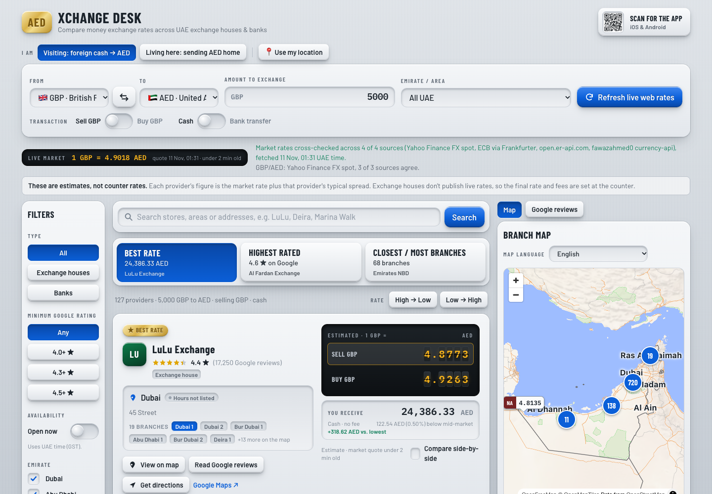

# Xchange Desk

**Compare money exchange rates across Dubai and Abu Dhabi, side by side.**

Xchange Desk is a React single-page app that lines up UAE exchange houses and banks (127 providers and about 890 branches across all seven emirates, including Al Ansari, Al Fardan, LuLu, UAE Exchange, Orient, Travelex, Emirates NBD and FAB) the way Skyscanner lines up flights: one search bar, quick filters, sortable result cards, a map and a reviews drawer. The interface is skeuomorphic, with recessed input wells, raised metal buttons, slide switches and split-flap rate boards.



---

## Contents

- [What it does](#what-it-does)
- [Quick start](#quick-start)
- [Data: what is live and what is not](#data-what-is-live-and-what-is-not)
- [How rates are calculated](#how-rates-are-calculated)
- [Project structure](#project-structure)
- [Configuration](#configuration)
- [Connecting real Google data](#connecting-real-google-data)
- [Deploying](#deploying)
- [Customising](#customising)
- [Design notes](#design-notes)
- [Known limitations](#known-limitations)
- [Roadmap](#roadmap)
- [Disclaimer](#disclaimer)

---

## What it does

### Search console
- **Currency pair** with a swap button: AED, USD, EUR, GBP, INR, PHP, PKR, SAR. Choosing the currency already set on the other side swaps them.
- **Amount** to exchange. Every card recalculates as you type.
- **Transaction type** with two slide switches:
  - *Sell AED / Buy AED*: you hand over the base currency, or you buy it.
  - *Cash / Bank transfer*: bank transfers get a tighter spread and a flat fee.
- **Emirate and area**: All UAE, Dubai only, Abu Dhabi only, or a neighbourhood (Deira, Bur Dubai, Marina, Downtown, Corniche, Mussafah).
- **Refresh live web rates** button, plus automatic refresh on load and every 60 seconds.

### Results
- **Three quick-sort tabs** in the Skyscanner style: *Best Rate*, *Highest Rated*, *Closest / Most Branches*. Each tab shows its current winner as a summary line.
  - *Closest* ranks by distance from the selected neighbourhood. With a whole-emirate filter it ranks by branch count.
- **Provider cards** show the logo plate, Google rating and review count, the nearest matching branch, an open/closed pill (UAE time), branch chips to switch branch, a split-flap board with estimated *Sell* and *Buy* rates, the converted total, fee, savings against the worst offer, the cost versus the mid-market rate, and the age of the market quote.
- **Metal badges** mark *Best rate* (gold), *Top rated* (steel) and *Most branches* (copper).
- **Side-by-side tray**: tick "Compare side-by-side" on 2 to 4 cards and a pinned multi-column table opens. The best value in each row is highlighted.
- **Left sidebar filters**: minimum Google rating, open now, emirate checkboxes, sort order, reset.

### Map and reviews
- **Rate pins map** is a real vector map (MapLibre on OpenFreeMap tiles). Every filtered branch is a tag carrying the provider mark and the rate for your transaction, and the tag's pointer sits exactly on the branch coordinate. Tags that would overlap group into a count circle; click it to zoom in.
- **Map language**: English, Arabic, Bengali, Tamil, Malayalam, Hindi or Urdu (remembered in the browser, and defaulted from the browser language), plus a "Standard map" option with street names in the local language. The base map has all of its own text removed and the app draws city, town and district labels itself, so every script renders correctly. Names come only from OpenStreetMap `name:xx` tags and Wikidata labels (built by `node scripts/build-map-places.mjs`); nothing is machine-translated. A place with no name in the chosen language is shown in English, and the panel says how many places have one (English 1,041, Arabic 974, Malayalam 254, Urdu 82, Bengali 22, Hindi 16, Tamil 14, out of 1,048). The Google Maps embed follows the same language.
- **Use my location** (browser geolocation) marks you on the map, features the three nearest branches with straight-line distances, shows a distance on each card and re-ranks the "Closest" sort.
- **Google Maps button** opens an embed of the selected branch in place, and minimizes back into a button.
- **Get directions** on every branch deep-links to Google Maps navigation.
- **Reviews drawer** shows aggregate rating, star ratings, reviewer, branch visited and relative time, filterable by branch.

### Ask Xchange (AI assistant)

A floating **Ask Xchange** button opens a chat panel. The assistant can answer questions *and* operate the page: "best rate for 1,000 USD to AED near Deira, open now", "compare the top three", "banks open now in Sharjah", "closest to me", "what should I bring?". It replies in the user's language.

- **Model:** Claude Haiku 5.5 (`claude-haiku-5-5`), thinking off, 1,024 output tokens per reply. Change it in `src/lib/chatSpec.js`.
- **Tools** run in the browser, on the same state and calculation code the page uses: `update_search`, `get_results`, `get_provider_details`, `compare_providers`, `show_on_map`, `find_nearest`. Tool inputs are validated before anything changes; bad input is returned to the model as an error and changes nothing.
- **No invented numbers:** every figure the assistant quotes comes from a tool result. Provider rates stay labelled as estimates, sample ratings as sample, and missing hours as "not listed".
- **Privacy:** the conversation is sent to Anthropic to produce answers. The server keeps no chat log, and the browser keeps the chat only in `sessionStorage` for the tab. Coordinates are never sent; the model only sees distances.

### Information pages

About, Methodology, Data sources (with live per-source update times), Contact, Privacy Policy and Terms of Service live at `/about`, `/methodology`, `/sources`, `/contact`, `/privacy` and `/terms`. They are lazy-loaded React pages behind a small History-API router (`src/lib/router.jsx`), with a rewrite in `vercel.json` so each path can be opened or shared directly. The app stays mounted while one is open, so filters, chat and map survive a visit. Business details (contact email, operator name, policy date) are in `src/data/site.js`. The footer shows when market rates and branch data were last updated.

### Mobile app QR code
A header badge shows a mini QR code. Clicking it opens a full-screen modal with a large scannable code ("Scan to download for iOS & Android").

---

## Quick start

Requirements: **Node.js 18 or newer** and npm.

```bash
git clone <your-repo-url> dxb-fx-compare
cd dxb-fx-compare
npm install
npm run dev
```

Open the URL Vite prints (normally <http://localhost:5173>). Live rates load automatically.

| Script | What it does |
| --- | --- |
| `npm run dev` | Dev server with hot reload and the live-rates proxy |
| `npm run build` | Production build into `dist/` |
| `npm run preview` | Serves the production build, with the same proxy |

---

## Data: what is live and what is not

Be clear about this before relying on any number.

| Data | Source | Status |
| --- | --- | --- |
| **Market (mid) FX rate** | Four independent feeds, cross-checked: Yahoo Finance FX spot (minute-level, major currencies), ECB via Frankfurter (daily, ~30 currencies), `open.er-api.com` (daily, ~160) and fawazahmed0 currency-api (daily, 300+) | **Live where possible.** For each currency a quote is discarded unless another source corroborates it (within 0.25% plus an allowance for market movement between quote times), then the freshest surviving quote wins. The UI shows the source, the quote age and how many sources agreed. Daily-only currencies are labelled "daily reference rate". |
| **Provider rates** (Sell / Buy) | Market rate plus a modelled per-provider spread | **Estimated.** None of the exchange houses offers a public rates API, and their sites load rates through private services, so genuine counter rates can't be collected legitimately. |
| Provider ratings and review counts | `src/data/seed.js` | **Sample snapshot**, replaceable with Google Places data. |
| Reviews | `src/data/seed.js` | **Sample text written for this project**, not copied from Google. Labelled as such in the UI. |
| Branch coordinates | `src/data/seed.js` | **Approximate** positions per neighbourhood. |
| Opening hours | `src/data/seed.js` | Sample hours, evaluated against UAE time (Asia/Dubai). |

On weekends the forex market is closed, so the live quote is the last close (for example Friday night). The quote time next to the "Live market" strip tells you exactly which moment you are looking at.

If the live source is unreachable, the app keeps the last known rates and shows a red status message. It retries every minute.

---

## How rates are calculated

All maths lives in [`src/lib/pricing.js`](src/lib/pricing.js).

1. **Mid rate.** For base currency `B` and target `T`, with all rates stored as units per 1 AED:

   ```
   mid(B→T) = ratePerAED[T] / ratePerAED[B]
   ```

2. **Provider spread.**

   ```
   spread% = max(0.15, margin + bias[T] + 0.5 × bias[B] + (bank ? −0.20 : 0))
   weBuy   = mid × (1 − spread%)      // provider buys your base currency; you receive this many T per B
   weSell  = mid × (1 + spread%)      // provider sells base currency; you pay this many T per B
   ```

   `margin`, `bias` (per currency) and `fee` are defined per provider in `seed.js`.

3. **Totals.**

   ```
   Sell mode: you receive = (amount − feeBase) × weBuy
   Buy mode:  you pay     = (amount + feeBase) × weSell
   feeBase    = feeAED × ratePerAED[B]      // 0 for cash
   ```

4. **Best rate.** In sell mode the highest "you receive" wins. In buy mode the lowest "you pay" wins. The "vs. lowest" or "vs. priciest" figure on each card is measured against the worst offer in the current result set.

To use real counter rates, replace the spread model in `quote()` with rates you have collected, or add a per-provider override table.

---

## Project structure

```
dxb-fx-compare/
├── index.html                    Fonts and root element
├── vite.config.js                Vite + React, the /api/yahoo proxy, and a dev route for /api/chat
├── vercel.json                   Yahoo rewrite and the chat function's time limit
├── api/
│   ├── yahoo.js                  Serverless proxy to Yahoo Finance
│   └── chat.js                   Serverless relay to Claude (streams SSE, holds the API key)
├── tailwind.config.js            Palette, fonts, skeuomorphic shadow scale
├── postcss.config.js
├── .env.example                  ANTHROPIC_API_KEY and optional limits
├── docs/screenshot.png
└── src/
    ├── main.jsx                  Entry point
    ├── App.jsx                   State, filtering, sorting, layout
    ├── index.css                 Tailwind layers and component classes
    │                             (.panel, .well, .btn, .key, .switch, .board, .flip-digit, badges)
    ├── pages/                    About, Methodology, Sources, Contact, Privacy, Terms (+ PageShell)
    ├── data/
    │   ├── site.js               Contact email, operator name, policy date, page list
    │   └── seed.js               Currencies, areas, providers, branches, sample reviews, offline rates
    ├── services/
    │   └── fxDataService.js      Data adapter: getSnapshot, refreshLiveRates, enrichFromGoogle
    ├── lib/
    │   ├── pricing.js            Quote and conversion maths, open-now, distance, deep links
    │   ├── results.js            Row derivation, sorting and filter-merging shared by the page and the assistant
    │   ├── chatSpec.js           Assistant model, limits, system prompt and tool schemas (used by server and browser)
    │   ├── chatTools.js          The assistant's tools; they run in the browser against live page state
    │   └── chatClient.js         Streams /api/chat and runs the tool loop
    └── components/
        ├── SearchConsole.jsx     Pair, amount, switches, area, refresh
        ├── Sidebar.jsx           Rating, open now, emirate, sort
        ├── SortTabs.jsx          Best Rate / Highest Rated / Closest tabs
        ├── ProviderCard.jsx      Result card with rate board
        ├── MapPanel.jsx          MapLibre rate-pin map with language picker, location marker and Google Maps button
        ├── ChatLauncher.jsx      Floating button; lazy-loads the chat panel
        ├── ChatPanel.jsx         Chat UI: suggestions, streaming replies, action chips, stop / new chat
        ├── ReviewsDrawer.jsx     Reviews view
        ├── CompareTray.jsx       Pinned side-by-side table
        ├── QrBadge.jsx           Header badge, full-screen QR modal, app link constant
        └── ui.jsx                Stars, Switch, FlipRate, Mark, Pill, icons
```

### The data adapter

`fxDataService` is the only module that knows where data comes from. Components never call `fetch`.

```js
getSnapshot()          // offline-safe seed: providers, branches, reviews, mid rates
refreshLiveRates()     // → { mid, quoteTimes, sourceInfo, dailyCodes, updatedAt, host }  four feeds, cross-checked
enrichFromGoogle(list) // → { providers, enriched }  no-op until VITE_PLACES_PROXY is set
```

---

## Configuration

| Setting | Where | Purpose |
| --- | --- | --- |
| `VITE_PLACES_PROXY` | `.env` | URL of your Google Places proxy. Leave empty to use the sample ratings and reviews. |
| `ANTHROPIC_API_KEY` | `.env.local` (dev) / `vercel env add ANTHROPIC_API_KEY` (production) | Turns the assistant on. Server-side only: never prefix it with `VITE_`. Without it the chat shows "not switched on yet" and nothing else changes. |
| `CHAT_REQUESTS_PER_10_MIN`, `CHAT_DAILY_CAP` | environment | Best-effort limits per visitor and per day (defaults 40 and 4,000). They are per server instance; the hard ceiling is the monthly spend limit you set in the Anthropic Console. |
| `APP_DOWNLOAD_URL` | `src/components/QrBadge.jsx` | The link encoded in the QR code. **It is a placeholder (`https://example.com/get-xchange-desk`). Replace it with your real app smart link before sharing the app.** |
| Refresh interval | `src/App.jsx` (`setInterval(..., 60000)`) | How often live rates reload. |
| Providers, spreads, fees | `src/data/seed.js` | Per-provider `margin`, `bias`, `fee`, branches. |

---

## Connecting real Google data

The browser must never hold a Google API key, so the app expects a small server route you control.

1. Enable **Places API (New)** in Google Cloud and create a key restricted to your server.
2. Add a route (for example `GET /api/places?q=Al Ansari Exchange UAE`) that calls `places:searchText` and then Place Details, and returns a place object with at least:

   ```json
   {
     "rating": 4.5,
     "userRatingCount": 21480,
     "reviews": [
       {
         "authorAttribution": { "displayName": "Name" },
         "rating": 5,
         "publishTime": "2026-10-01T10:00:00Z",
         "text": { "text": "Review text" }
       }
     ]
   }
   ```

3. Set `VITE_PLACES_PROXY=https://your-host/api/places` in `.env`.

When enrichment succeeds, the sample-review notice disappears and the reviews are marked as coming from Google. Follow Google's terms for displaying and attributing reviews, and its caching limits. For exact branch coordinates, extend the same route to return each branch's `location` and merge it into `branches`.

---

## Deploying

`npm run build` produces a static site in `dist/`. The only part that needs a server is the **live-rates proxy**, because Yahoo's endpoint sends no CORS headers and wants a User-Agent. Without it, the app falls back to a daily rate feed.

Provide `/api/yahoo/*` on your host, forwarding to `https://query1.finance.yahoo.com/*`. A minimal Node example:

```js
// server.js: serves dist/ and the proxy
import express from 'express';
const app = express();
app.use('/api/yahoo', async (req, res) => {
  const r = await fetch(`https://query1.finance.yahoo.com${req.url}`, {
    headers: { 'User-Agent': 'Mozilla/5.0 (compatible; xchange-desk)' },
  });
  res.status(r.status).type('json').send(await r.text());
});
app.use(express.static('dist'));
app.listen(8080);
```

**The assistant** needs a server too: `api/chat.js` is a standard Vercel function (it is the same file `npm run dev` serves). Add `ANTHROPIC_API_KEY`, redeploy, and set a monthly spend limit in the Anthropic Console. On another host, expose the same handler at `POST /api/chat`. It accepts `{messages, context}` and streams server-sent events (`text`, `done`, `error`).

For heavier traffic, cache each symbol for 30 to 60 seconds on the server. Yahoo's endpoint is unofficial and has no guaranteed uptime or licence for commercial redistribution. For a production product, use a licensed FX data provider (for example a paid API with an SLA) and point `fromYahoo()` in `fxDataService.js` at it.

---

## Customising

**Add a provider.** Append an object to `PROVIDERS` in `src/data/seed.js` with `id`, `name`, `mark` (two letters), `hue`, `rating`, `reviewCount`, `margin`, `fee`, `bias`, `branches` and `reviews`. Use the `branch()` helper for branches.

**Add a currency.** Every currency the daily feeds carry (about 160) appears automatically. To give one a minute-level live quote, add it to `CURRENCIES` and `SEED_MID_PER_AED` in `seed.js`; Yahoo must offer a `USD<code>=X` symbol for it.

**Add an area.** Add an entry to `AREAS` (with a centre point) and to `PLACE` in `seed.js`, then use the area name on branches.

**Restyle.** Colours, fonts and the shadow scale are in `tailwind.config.js`. The reusable skeuomorphic pieces are Tailwind `@apply` classes in `src/index.css`.

---

## Design notes

- **Physical cues:** recessed `shadow-well` inputs, raised buttons with layered drop shadows and a `border-t border-white/60` top-edge highlight, slide switches with a bevelled knob, brass, steel and copper badge gradients.
- **Rate boards:** black glass panel, amber LED digits on individual hinged tiles with a centre seam.
- **Type:** Barlow Condensed for headings and board labels, Barlow for text, IBM Plex Mono for figures.
- **Layout:** three columns on wide screens (filters, results, map and reviews). On narrower screens the filters stack above the results and the map panel below them.
- **Accessibility:** native selects and inputs, visible focus rings, `role="switch"` and `aria-pressed` states, `aria-live` status messages, Escape closes the QR modal, and `prefers-reduced-motion` is respected.

---

## Known limitations

- Provider rates are modelled, not scraped. The market rate is accurate, the counter rate is an estimate.
- Ratings, reviews, hours and branch pins are sample data until the Places proxy is connected.
- The Yahoo endpoint is unofficial. It can change or block requests without notice.
- Branch coordinates are placeholders (area centre plus a small offset) until the Places proxy supplies real ones, so "nearest" is only as accurate as that data.
- The Google Maps button embeds one branch at a time. A multi-pin Google map would need the Maps JavaScript API and a key.
- Layout has been checked at desktop width. Phone layouts use stacking rules but have had less testing.
- No automated tests yet.

---

## Roadmap

- Licensed real-time FX source with server-side caching
- Real Google Places ratings, reviews, hours and coordinates
- Per-provider rate overrides and a "last verified at counter" stamp
- Rate history sparkline per pair
- Geolocation for true "closest" ranking
- Shareable URLs for a search (pair, amount, filters)
- Unit tests for `pricing.js` and component tests for the cards

---

## Where the exchange houses and banks come from

The provider list is built from **OpenStreetMap** (© OpenStreetMap contributors, ODbL): every tagged `amenity=bureau_de_change` and `amenity=bank` in the UAE, grouped by brand. That gives real names and real coordinates, with opening hours where mappers added them. Refresh it with `node scripts/build-osm-data.mjs` (it writes `src/data/osm-uae.json` and resumes if interrupted).

- Exchange houses: every named brand is included (95). Unnamed bureaus are skipped.
- Banks: only brands with 3 or more branches (32), and OpenStreetMap does not say whether a given branch exchanges currency, so confirm before you go.
- The first eight exchange houses keep their hand-written spread profiles, sample ratings and sample reviews. Every other provider has **no rating or reviews** (none are invented) and uses one **category-average spread**, so their rates are identical until real rates are available.
- OpenStreetMap coverage is incomplete and can be out of date, and branch emirates are taken from the official boundaries (Abu Dhabi is "everything else").

## Disclaimer

Xchange Desk is an independent comparison tool. It is not affiliated with, endorsed by or sponsored by any exchange house named in it, and provider names appear only to identify the businesses being compared. Monogram plates are placeholders, not official logos. Rates shown are indicative and not an offer. Confirm the final rate, fee and any limits with the provider before you transact.

## Licence

No licence has been chosen yet. Until one is added, all rights are reserved by the author.
